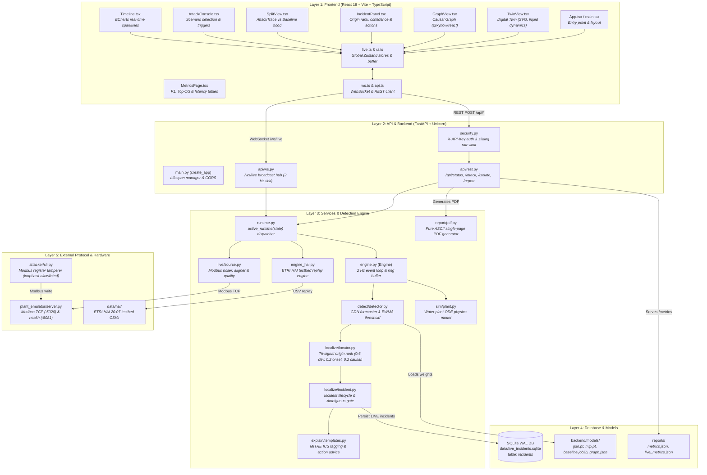
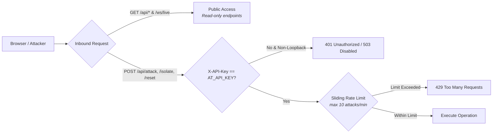

# AttackTrace: Full Interactive Architecture Map

> Generated by **Archify / Graphify** code analysis across **1,937 nodes**, **6,421 edges**, and **80 community clusters**.

---

## 🌐 Interactive Visualization Artifacts
The repository includes several standalone, interactive architecture visualizers:

- [**Interactive Graph Visualization (2D/3D Force-Directed)**](file:///c:/Users/jinsu/Documents/My%20Projects/Attacktrace/graphify-out/graph.html): Visual knowledge graph with node clustering, search, filters, and community boundaries.
- [**Interactive Call-Flow & Component Hierarchy**](file:///c:/Users/jinsu/Documents/My%20Projects/Attacktrace/graphify-out/Attacktrace-callflow.html): Interactive Mermaid call-flow diagrams with pan/zoom controls and call tables.
- [**D3 Collapsible Architecture Tree**](file:///c:/Users/jinsu/Documents/My%20Projects/Attacktrace/graphify-out/GRAPH_TREE.html): Hierarchical file and symbol explorer.
- [**Graph Analysis Report**](file:///c:/Users/jinsu/Documents/My%20Projects/Attacktrace/graphify-out/GRAPH_REPORT.md): Summary of graph density, community hubs, and dependencies.

---

## 1. Five-Layer Architecture Map



---

## 2. Layer-by-Layer Breakdown & Source Evidence

### 🎨 Layer 1: Frontend
| Component / Module | Source File | Description |
|---|---|---|
| **Entry Point** | [`frontend/src/main.tsx`](file:///c:/Users/jinsu/Documents/My%20Projects/Attacktrace/frontend/src/main.tsx) | Mounts React root into DOM element `#root`. |
| **Main App Shell** | [`frontend/src/app/App.tsx`](file:///c:/Users/jinsu/Documents/My%20Projects/Attacktrace/frontend/src/app/App.tsx) | Controls layout, mode switching, center view routing (Twin vs Graph vs Split), and error banners. |
| **Digital Twin** | [`frontend/src/features/twin/TwinView.tsx`](file:///c:/Users/jinsu/Documents/My%20Projects/Attacktrace/frontend/src/features/twin/TwinView.tsx) | SVG animated visualization of tanks T1/T2 with liquid levels, valves MV101, PLCs, and pumps. |
| **Node Badges** | [`frontend/src/features/twin/NodeBadge.tsx`](file:///c:/Users/jinsu/Documents/My%20Projects/Attacktrace/frontend/src/features/twin/NodeBadge.tsx) | Badges displaying real-time sensor metrics, quality flags, and spoofed vs true readings. |
| **Causal Graph** | [`frontend/src/features/graph/GraphView.tsx`](file:///c:/Users/jinsu/Documents/My%20Projects/Attacktrace/frontend/src/features/graph/GraphView.tsx) | Interactive directed graph layout built on `@xyflow/react` showing propagation pulses. |
| **Incident Panel** | [`frontend/src/features/incident/IncidentPanel.tsx`](file:///c:/Users/jinsu/Documents/My%20Projects/Attacktrace/frontend/src/features/incident/IncidentPanel.tsx) | Displays top candidate origin, confidence scores, propagation sequence, and MITRE ICS IDs. |
| **Containment Action** | [`frontend/src/features/incident/IsolateButton.tsx`](file:///c:/Users/jinsu/Documents/My%20Projects/Attacktrace/frontend/src/features/incident/IsolateButton.tsx) | One-click button to isolate the compromised component and initiate process recovery. |
| **Split Comparison** | [`frontend/src/features/split/SplitView.tsx`](file:///c:/Users/jinsu/Documents/My%20Projects/Attacktrace/frontend/src/features/split/SplitView.tsx) | Side-by-side view contrasting baseline alarm flooding (6+ nodes) with AttackTrace. |
| **Attack Console** | [`frontend/src/features/console/AttackConsole.tsx`](file:///c:/Users/jinsu/Documents/My%20Projects/Attacktrace/frontend/src/features/console/AttackConsole.tsx) | Allows operators to launch 5 attack scenarios (offset, ramp, freeze, actuator force, setpoint). |
| **Telemetry Timeline** | [`frontend/src/features/timeline/Timeline.tsx`](file:///c:/Users/jinsu/Documents/My%20Projects/Attacktrace/frontend/src/features/timeline/Timeline.tsx) | ECharts streaming sparklines with time scrubbing and pause/resume controls. |
| **Metrics Dashboard** | [`frontend/src/features/metrics/MetricsPage.tsx`](file:///c:/Users/jinsu/Documents/My%20Projects/Attacktrace/frontend/src/features/metrics/MetricsPage.tsx) | Full benchmark tables for F1 score, Top-1/Top-3 localization accuracy, and Modbus latency. |
| **Zustand Store** | [`frontend/src/store/live.ts`](file:///c:/Users/jinsu/Documents/My%20Projects/Attacktrace/frontend/src/store/live.ts) | Centralized state store managing telemetry buffer, active incidents, and connection health. |
| **WebSocket Client** | [`frontend/src/lib/ws.ts`](file:///c:/Users/jinsu/Documents/My%20Projects/Attacktrace/frontend/src/lib/ws.ts) | Resilient WebSocket connection to `/ws/live` with exponential backoff and message deduplication. |

---

### ⚡ Layer 2: API & Gateway
| Component / Module | Source File | Description |
|---|---|---|
| **FastAPI Root** | [`backend/app/main.py`](file:///c:/Users/jinsu/Documents/My%20Projects/Attacktrace/backend/app/main.py) | Application factory (`create_app`), async lifespan management, CORS configuration. |
| **Security & Auth** | [`backend/app/api/security.py`](file:///c:/Users/jinsu/Documents/My%20Projects/Attacktrace/backend/app/api/security.py) | Header-based authentication (`X-API-Key == AT_API_KEY`), sliding-window attack rate limiting. |
| **REST Controller** | [`backend/app/api/rest.py`](file:///c:/Users/jinsu/Documents/My%20Projects/Attacktrace/backend/app/api/rest.py) | Endpoints: `GET /api/status`, `POST /api/mode`, `POST /api/attack`, `POST /api/isolate`, `GET /api/incidents`, `GET /api/incidents/{id}/report.pdf`. |
| **WebSocket Hub** | [`backend/app/api/ws.py`](file:///c:/Users/jinsu/Documents/My%20Projects/Attacktrace/backend/app/api/ws.py) | Broadcast hub dispatching engine telemetry ticks to connected frontends at 2 Hz (`/ws/live`). |
| **Pydantic Schemas** | [`backend/app/schemas.py`](file:///c:/Users/jinsu/Documents/My%20Projects/Attacktrace/backend/app/schemas.py) | Strict data schemas for `Sample`, `Incident`, `OriginCandidate`, `PathStep`, and `AttackRequest`. |

---

### 🧠 Layer 3: Services & Detection Engine
| Component / Module | Source File | Description |
|---|---|---|
| **Core Engine** | [`backend/app/engine.py`](file:///c:/Users/jinsu/Documents/My%20Projects/Attacktrace/backend/app/engine.py) | Orchestrates physics step, detector execution, localization ranking, and 5-minute ring buffer. |
| **Runtime Dispatcher** | [`backend/app/runtime.py`](file:///c:/Users/jinsu/Documents/My%20Projects/Attacktrace/backend/app/runtime.py) | Polymorphic runtime switcher selecting `Engine` (SIM), `HaiEngine` (HAI), or `LiveRuntime` (LIVE). |
| **GDN Forecaster** | [`backend/app/detect/forecaster.py`](file:///c:/Users/jinsu/Documents/My%20Projects/Attacktrace/backend/app/detect/forecaster.py) | Graph Deviation Network with graph attention layers predicting expected sensor values. |
| **Streaming Detector** | [`backend/app/detect/detector.py`](file:///c:/Users/jinsu/Documents/My%20Projects/Attacktrace/backend/app/detect/detector.py) | Calculates forecast residuals, applies EWMA filter ($\alpha = 0.25$), and checks 3-sample persistence. |
| **Baseline Detector** | [`backend/app/detect/baseline.py`](file:///c:/Users/jinsu/Documents/My%20Projects/Attacktrace/backend/app/detect/baseline.py) | Traditional baseline: Isolation Forest combined with $3\sigma$ thresholding for split comparison. |
| **Origin Localizer** | [`backend/app/localize/locator.py`](file:///c:/Users/jinsu/Documents/My%20Projects/Attacktrace/backend/app/localize/locator.py) | Tri-signal ranking algorithm: $0.6 \times \text{Deviation} + 0.2 \times \text{Onset} + 0.2 \times \text{Causal}$. |
| **Incident Manager** | [`backend/app/localize/incident.py`](file:///c:/Users/jinsu/Documents/My%20Projects/Attacktrace/backend/app/localize/incident.py) | Manages incident states (`new`, `active`, `contained`, `closed`) and evaluates ambiguity gates. |
| **MITRE ICS Mapper** | [`backend/app/explain/templates.py`](file:///c:/Users/jinsu/Documents/My%20Projects/Attacktrace/backend/app/explain/templates.py) | Maps components to MITRE ATT&CK for ICS technique IDs (`T0856`, `T0831`, `T0855`) and actions. |
| **Plant Simulator** | [`backend/app/sim/plant.py`](file:///c:/Users/jinsu/Documents/My%20Projects/Attacktrace/backend/app/sim/plant.py) | 10 Hz Euler ODE numerical solver simulating 2-stage water plant hydraulics and control logic. |
| **Live Modbus Source** | [`backend/app/live/source.py`](file:///c:/Users/jinsu/Documents/My%20Projects/Attacktrace/backend/app/live/source.py) | Non-blocking Modbus TCP poller, sample aligner, and quality tracking engine (`Good`, `Stale`, `Frozen`). |
| **PDF Report Service** | [`backend/app/report/pdf.py`](file:///c:/Users/jinsu/Documents/My%20Projects/Attacktrace/backend/app/report/pdf.py) | Dependency-free ASCII/PostScript PDF engine generating official 1-page audit certificates. |

---

### 💾 Layer 4: Storage & Data Persistence
| Component / Module | Source File | Description |
|---|---|---|
| **Incident SQLite DB** | [`backend/app/live/store.py`](file:///c:/Users/jinsu/Documents/My%20Projects/Attacktrace/backend/app/live/store.py) | SQLite database (`PRAGMA journal_mode=WAL`) storing full audit trails of LIVE mode incidents. |
| **Neural Weights** | [`backend/models/`](file:///c:/Users/jinsu/Documents/My%20Projects/Attacktrace/backend/models) | PyTorch model checkpoints (`gdn.pt`, `mlp.pt`), `baseline.joblib`, and causal graph structure. |
| **Evaluation Reports** | [`reports/`](file:///c:/Users/jinsu/Documents/My%20Projects/Attacktrace/reports) | Benchmark results (`metrics.json`, `live_metrics.json`) detailing F1 scores and latency percentiles. |

---

### 🏭 Layer 5: External Protocol & Hardware
| Component / Module | Source File | Description |
|---|---|---|
| **Plant Emulator** | [`plant_emulator/server.py`](file:///c:/Users/jinsu/Documents/My%20Projects/Attacktrace/plant_emulator/server.py) | Modbus TCP server on port `5020` simulating hardware registers for PLC coils and holding registers. |
| **Tag Map Configuration** | [`config/tagmap.yaml`](file:///c:/Users/jinsu/Documents/My%20Projects/Attacktrace/config/tagmap.yaml) | Mapping file linking human-readable tag names (`LIT101`, `MV101`) to Modbus register addresses. |
| **Attacker Tool** | [`attacker/cli.py`](file:///c:/Users/jinsu/Documents/My%20Projects/Attacktrace/attacker/cli.py) | Standalone penetration test tool allowlisted to loopback to inject sensor offsets via Modbus writes. |
| **HAI Testbed** | [`data/hai/`](file:///c:/Users/jinsu/Documents/My%20Projects/Attacktrace/data/hai) | Dataset files from Korean ETRI hardware testbed used for evaluation replay. |

---

## 3. End-to-End User Workflows

```mermaid
sequenceDiagram
    autonumber
    actor Operator as Plant Operator
    participant UI as React UI (Digital Twin)
    participant REST as FastAPI REST API
    participant Engine as Engine (2 Hz Loop)
    participant Plant as Sim Plant / Modbus Emulator
    participant GDN as GDN Forecaster
    participant Localizer as Tri-Signal Localizer
    participant Store as SQLite DB / PDF Engine

    Operator->>UI: 1. Select scenario & click "Launch" (e.g. LIT101 sensor offset)
    UI->>REST: POST /api/attack {target: "LIT101", scenario: "sensor_offset", mag: -25}
    REST->>Engine: launch(attack_spec)
    Engine->>Plant: Apply spoofing offset on LIT101
    
    loop Every 500 ms (2 Hz)
        Engine->>Plant: Step physics / Poll Modbus registers
        Plant-->>Engine: Telemetry sample (true & measured values)
        Engine->>GDN: predict(window)
        GDN-->>Engine: Forecast residual error
        Engine->>Localizer: check_sustained(errors)
        alt Residual exceeds threshold for 3 samples
            Localizer->>Localizer: Compute deviation (0.6) + onset (0.2) + causal (0.2)
            Localizer-->>Engine: Incident detected: Origin = LIT101 (84% conf)
            Engine->>Store: Save incident to SQLite
        end
        Engine-->>UI: WebSocket broadcast (Sample + Incident state)
    end

    UI->>UI: Status turns to INCIDENT; LIT101 badge glows; path highlights
    Operator->>UI: 2. Click "Isolate LIT101"
    UI->>REST: POST /api/isolate {incident_id, node_id: "LIT101"}
    REST->>Engine: isolate("LIT101")
    Engine->>Plant: Switch control loop to safe fallback / isolate sensor
    Plant-->>Engine: Tank levels stabilize; process recovers
    Engine-->>UI: Status changes to CONTAINED
    Operator->>UI: 3. Click "Report" icon
    UI->>REST: GET /api/incidents/{id}/report.pdf
    REST->>Store: Render PDF PostScript
    REST-->>Operator: 1-page incident audit report downloaded
```

---

## 4. Authentication, Authorization & Security Flow



- **Authentication**: Write endpoints (`/api/attack`, `/api/isolate`, `/api/mode`, `/api/reset`) require header `X-API-Key` matching `AT_API_KEY`.
- **Failsafe Design**: If `AT_API_KEY` is omitted on a non-loopback bind, write endpoints fail closed (HTTP 503) instead of leaving the demo open.
- **Rate Limiting**: Sliding window in [`RateLimiter`](file:///c:/Users/jinsu/Documents/My%20Projects/Attacktrace/backend/app/api/security.py#L18-L36) restricts attacks to 10 per minute per client IP.
- **Attacker Allowlist**: The Modbus attacker module (`attacker/`) is strictly locked to `127.0.0.1` and the docker compose network to prevent external network scanning.
