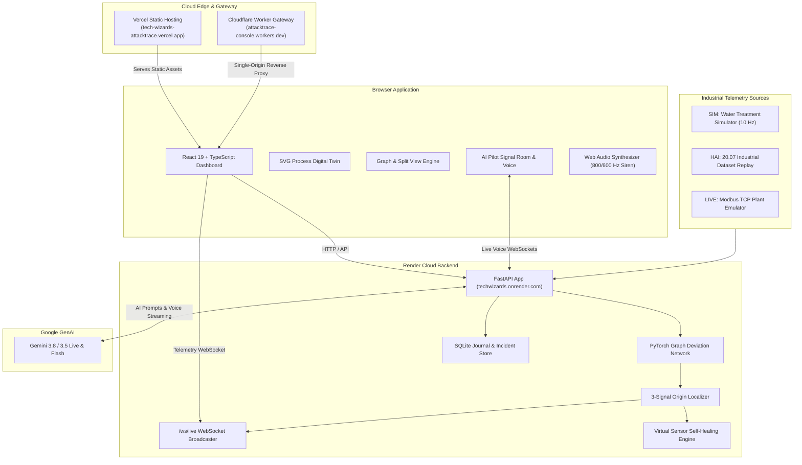

# AttackTrace

> **Cyber-Physical Attack Detection, Root-Cause Localization & Self-Healing Industrial Digital Twin**  
> *Sustainathon 2026 — Problem AI-07: Industrial Attack Localization & Explainability*

[](https://tech-wizards-attacktrace.vercel.app)
[](https://techwizards.onrender.com/api/status)
[](https://attacktrace-console.jinsu-j2005.workers.dev)
[](LICENSE)

---

## 🌐 Live Deployments

AttackTrace is deployed and operational across three coordinated cloud tiers:

| Tier | Service | URL | Role |
| :--- | :--- | :--- | :--- |
| **Frontend** | Vercel | [**tech-wizards-attacktrace.vercel.app**](https://tech-wizards-attacktrace.vercel.app) | Real-time React dashboard, Digital Twin, animated telemetry, and AI Pilot |
| **Backend** | Render | [**techwizards.onrender.com**](https://techwizards.onrender.com/api/status) | FastAPI backend, Graph Neural Network (GDN), Modbus engine, `/ws/live` stream |
| **Edge Gateway** | Cloudflare Workers | [**attacktrace-console.jinsu-j2005.workers.dev**](https://attacktrace-console.jinsu-j2005.workers.dev) | Single-origin edge gateway unifying Vercel & Render with strict security headers |

> [!NOTE]
> **Authentication Status**: The live dashboard runs in frictionless **Demo Mode** (`AT_AUTH_ENABLED=false`) for instant demonstration. Enterprise-grade Firebase Google Auth, JWT verification, and Role-Based Access Control (`admin`, `analyst`, `viewer`) remain built-in and can be toggled via `AT_AUTH_ENABLED=true`.

---

## 🚀 Key Features

### 1. Cyber-Physical Digital Twin & Telemetry Stream
- **Interactive 3-Stage Plant Simulation**: Visualizes a high-fidelity water treatment facility across **Stage 1 (Raw Intake & Storage)**, **Stage 2 (Filtration & Dosing)**, and **Stage 3 (Disinfection & Dispatch)**.
- **Synchronized Telemetry (2 Hz / 10 Hz)**: Real-time tank fill levels, dynamic pipe flow animations, pump speeds, sensor readings (`LIT101`, `FIT201`, `PIT301`, `LIT301`), and multi-track scrolling waveform timeline.
- **Graph & Split Views**: Toggle between the physical schematic twin, the learned causal process graph with propagation pulses, and the **Split View** comparing alert volumes against standard baselines.

### 2. Multi-Signal Detection & Root-Cause Localization
- **Graph Deviation Network (GDN)**: Employs graph attention neural networks and forecasting error residuals over learned causal dependencies.
- **Three-Signal Localization Algorithm**: Ranks the attack origin by balancing:
  $$\text{Score} = 0.6 \times \text{Deviation} + 0.2 \times \text{Onset Time} + 0.2 \times \text{Causal Topology}$$
- **MITRE ATT&CK for ICS**: Automatically tags attacks with tactics and techniques (e.g., `T0856: Impair Process Control`, `T0831: Manipulation of Control`).

### 3. Virtual Sensor Self-Healing
- **Closed-Loop Mitigation**: Clicking **Isolate** on a compromised sensor immediately swaps corrupted physical telemetry for physics-based predictive estimations.
- **Continuous Plant Operation**: Tank levels smoothly return to 50% setpoints without tripping emergency emergency shutdowns or wasting water/power.
- **Forensic PDF Export**: One-click generation of court-admissible forensic incident reports documenting attack onset, propagation paths, and self-healing recovery audits.

### 4. AI Pilot · Signal Room & Gemini Live Voice
- **Multi-Model Intelligence**: Backed by Google Gemini (`gemini-3.8-flash`, `gemini-3.8-live`, `gemini-3.5-flash-lite`, and `gemma-4-31b-it`).
- **Live Bidirectional Voice Assistant**: Real-time WebSockets streaming voice investigations with stateful audio waveforms (listening, thinking, speaking, muting).
- **Incident Grounding**: Automatically ingests incident context, evidence records, and telemetry states to answer root-cause questions and recommend operational SOPs without hallucinating.

### 5. Multi-Source Ingestion Modes
- **SIM Mode**: Live physics simulation with 5 injected cyber-physical attack scenarios:
  1. *Sensor Offset*: Spoofs constant bias into level or flow measurements.
  2. *Sensor Freeze*: Locks transmitter output at stale values.
  3. *Sensor Ramp*: Subtly drifts readings over time to evade simple threshold triggers.
  4. *Scaling Factor*: Multiplicatively skews sensor telemetry.
  5. *Replay Attack*: Replays benign historical recordings during an active process upset.
- **HAI Mode**: Replay of the real-world industrial security dataset (HAI 20.07).
- **LIVE Mode**: Direct Modbus TCP ingestion from software plant emulators with sub-2ms read latency.

### 6. Investigation SOC Workspace
- **Alerts** (`/alerts`): Centralized triage queue for prioritized security alerts.
- **Assets** (`/assets`): Health tracking across physical sensors, PLCs, pumps, and valves.
- **Investigations** (`/investigations`): Case management system persisting analyst notes and confidence metrics to SQLite.
- **Attribution Lab** (`/lab`): Attribution diagnostics and firmware attestation sandbox.
- **Metrics** (`/metrics`): Live benchmark evaluations, ROC curves, and baseline comparison tables.

---

## 🏛 Architecture



---

## 📊 Benchmark & Evaluation Results

Evaluated on held-out test attacks across 50 attack runs (10 per scenario), 20 clean 5-minute runs, and unseen random seeds. Source: `reports/metrics.json`.

| Metric | AttackTrace (Our GDN) | Baseline (Isolation Forest + 3σ) | Improvement |
| :--- | :---: | :---: | :---: |
| **Detection F1** | **0.904** | 0.766 | **+18.0%** |
| **False Alarms / Hour** | **0.0** | 3.6 | **100% reduction** |
| **Origin Top-1 Accuracy** | **84.0%** | 68.0% | **+23.5%** |
| **Origin Top-3 Accuracy** | **100.0%** | 86.0% | **+16.3%** |
| **Mean Localization Time** | **23.3 s** | *N/A (Alarm flood)* | — |
| **Self-Healing Containment**| **40 / 48 (83.3%)** | 0 / 48 | **Automated recovery** |

- **LIVE Mode (Modbus TCP)**: Detection F1 **0.951**, Top-1 Origin **83.3%**, read latency **p50 1.6 ms / p95 2.4 ms** (`reports/live_metrics.json`).
- **HAI 20.07 Dataset**: Strict F1 **0.428**, Point-adjusted F1 **0.915**, detecting 22 of 28 real-world physical attacks.

---

## ⚡ Quick Start

### Option 1: Open the Live Cloud Dashboard
Simply visit [https://tech-wizards-attacktrace.vercel.app](https://tech-wizards-attacktrace.vercel.app) or [https://attacktrace-console.jinsu-j2005.workers.dev](https://attacktrace-console.jinsu-j2005.workers.dev). No installation required.

### Option 2: Run with Docker Compose
```bash
# 1. Clone repository
git clone https://github.com/jinsu-2005/TechWizards.git
cd TechWizards

# 2. Configure environment
cp .env.example .env
# Optional: Add GEMINI_API_KEY in .env to enable AI Pilot features

# 3. Start full stack (Frontend, Backend, and Models)
docker compose up --build

# 4. Open in browser:
# UI:  http://localhost:5173
# API: http://localhost:8000/api/status
```

### Option 3: Local Development
```bash
# Prerequisites: Python 3.11+, Node.js 22+

# Backend
cd backend
python -m venv .venv
source .venv/bin/activate    # Windows: .venv\Scripts\activate
pip install -e .
uvicorn app.main:app --reload --port 8000

# Frontend
cd ../frontend
npm install
npm run dev
```

---

## 🎮 Interactive Live Demo Script

1. **Verify Baseline State**: Open the dashboard. Top right status pill reads **Normal** (green).
2. **Enable Audio**: Click the **Speaker** icon in the header to activate Web Audio synthesis.
3. **Launch an Attack**:
   - In the **Attack Console** (left pane), select **Sensor offset**.
   - Target **LIT101** with Magnitude `-25%`.
   - Click **Launch**.
4. **Observe Real-Time Detection**:
   - Within seconds, an audible dual-frequency warble siren (800 Hz / 600 Hz) triggers and the panel border pulses red.
   - The **Incident Panel** highlights `LIT101` as the Top-1 origin candidate with a high confidence score.
   - Attack propagation traces toward pumps `P101`, `P301`, and Tank 2.
5. **Engage AI Pilot (Signal Room)**:
   - Click **AI Pilot** in the top bar.
   - Ask: *"Why was LIT101 identified as the origin?"* or *"What physical damage will occur?"*
   - Or start **Live Voice** to conduct a hands-free conversational inquiry with Gemini.
6. **Activate Self-Healing**:
   - Click **Isolate LIT101** in the incident panel or inside the AI Pilot drawer.
   - A major-chord containment chime sounds.
   - LIT101 receives a cyan **VIRTUAL** badge.
   - The virtual sensor prediction takes over pump regulation, smoothly returning Tank 1 to equilibrium.
7. **Export Forensics**:
   - Click the **PDF Report** icon in the incident card to download an audit summary.

---

## 🗺 Codebase Navigation & Knowledge Graph

This repository is indexed with **Graphify** (`graphify-out/`), featuring a 2,871-node knowledge graph capturing dependencies, AST symbols, and cross-subsystem call flows.

You can inspect or query the graph directly:
```bash
# Query any architectural concept or component
graphify query "How does virtual sensor self-healing work?"

# Find shortest path between two symbols
graphify path "Engine" "VirtualSensor"

# Open interactive visual graph in browser
# View file: graphify-out/graph.html
```

---

## 📄 License & Attribution

- **Project License**: MIT License (see [`LICENSE`](LICENSE)).
- **Third-Party Disclosures**: Third-party libraries, datasets (HAI 20.07), fonts, and MITRE ICS tags are documented in [`submission/THIRD_PARTY.md`](submission/THIRD_PARTY.md).
