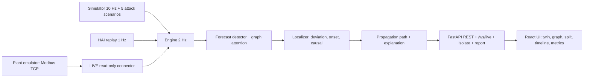

# AttackTrace

Private-server work now includes Firebase Google sign-in integration, server-enforced roles,
protected APIs/telemetry, Copilot polish and persistent journal storage. See the
[setup requirements](docs/FIREBASE_PRIVATE_SETUP.md) and
[delivery status](docs/COPILOT_PRIVATE_FOUNDATION_DELIVERY.md). Server credentials, actual OAuth,
visual verification and deployment checks remain outstanding. Docker Compose defaults to private
authentication; configure the server identity and HTTPS before using it. The dev override remains
an explicitly local simulator/emulator environment.

The [Vercel + Render deployment package](docs/VERCEL_RENDER_DEPLOYMENT.md) includes a single-origin
Cloudflare gateway, persistent Render paths, a private emulator and deployment checks. The planned
public entry is `attacktrace-console.jinsu-j2005.workers.dev`; it has not been published. Hosted
resources and Google runtime identity remain to be configured.

The Metrics screen includes a separate SIM stress study covering slow attacks, multiple origins, benign faults, noise, topology errors and confidence reliability. Read [the measured findings](docs/STRESS_VALIDATION.md). Regenerate it with `scripts/eval-robustness.ps1`; fitted calibration stays diagnostic and does not modify live rankings.

Local SOC workspace: [Alerts](http://localhost:5173/alerts), [Assets](http://localhost:5173/assets), [Investigations](http://localhost:5173/investigations), and [Local attribution lab](http://localhost:5173/lab). The Digital Twin and Process Graph share asset selection and an evidence inspector. Cases and analyst decisions persist across simulator resets.

See [delivery notes and remaining validation](docs/SOC_GRAPH_ENHANCEMENT_PLAN.md) and the [local investigation checklist](docs/LOCAL_INVESTIGATION_RUNBOOK.md). Local lab changes target only the software emulator; real firmware attestation is not implemented. Run `python -m eval.local_layers` from `backend` for the reproducible paired-evidence checks.

Detects an attack on an industrial control process, ranks the origin component, and traces the propagation path. Sustainathon 2026, problem AI-07 Attack-Localization.

## What it does
- Input: a live stream of sensor and actuator values (2 Hz) from a simulated water plant, a replay of the HAI 20.07 dataset, or a real Modbus TCP read from an emulated plant (LIVE mode).
- Detects: forecast-error scores over a learned causal graph, EWMA, 3-sample persistence.
- Localizes: ranks the origin with three signals (deviation 0.6, onset 0.2, causal 0.2).
- Explains: propagation path with onset times, MITRE ATT&CK for ICS tag, recommended action.
- Investigation Copilot: local evidence summaries with optional configured Gemini assistance, saved model references, ranked hypotheses, alternatives and suggested checks. Its output is not an approved plant SOP or proof of compromise.
- Virtual sensor estimation: simulator isolation can substitute an estimated sensor reading. Subsequent simulator state determines containment; safe operation and recovery are not guaranteed. LIVE monitoring remains read-only.
- Immersive Web Audio Alarms: zero-dependency browser synthesizer generating alternating dual-frequency sirens (800 Hz / 600 Hz) on incident detection and major-chord containment chimes on recovery.
- Contains: `Isolate` acts on the answer and engages Virtual Sensor Self-Healing. Each incident exports a one-page PDF including self-healing audit logs.
- Compares: a baseline (Isolation Forest + 3σ) floods 6 alarms where AttackTrace names 1 origin.

## Quick start
```bash
cp .env.example .env            # Windows: copy .env.example .env
# Add your GEMINI_API_KEY to .env for AI Industrial Copilot capabilities
docker compose up --build       # first start trains the models: 22 s measured; +~2 min if reports/metrics.json is missing
# UI  http://localhost:5173      API  http://localhost:8000/api/status
```
`.env.example` sets a demo key (`AT_API_KEY`, `VITE_API_KEY`) that protects the write endpoints; change it before exposing the demo.
Local dev: Python 3.11/3.12, Node 22, `make setup`, `make dev`. Checks: `make lint`, `make test`. Evaluation: `make eval` rewrites `reports/metrics.json`.

LIVE mode (optional, real protocol) reads the local Modbus emulator. A saved detector under `backend/models/live/` is reused on startup. If none exists, selecting LIVE starts a five-minute recording (600 accepted samples at 2 Hz), followed by model training. Once started, collection continues while SIM or HAI is selected. Rejected readings and training failures are explained on screen; a training failure preserves the recording and requires an explicit restart instead of silently repeating calibration. See [calibration behavior and the next implementation plan](docs/LIVE_CALIBRATION_AND_NEXT_PLAN.md). `make emulator` starts the emulator, `make live-train` records and trains using `AT_LIVE_TRAIN_MIN` (default 5; use 20 for the longer historical setup), and `make eval-live` rewrites `reports/live_metrics.json`. Attacks against LIVE mode use the allowlisted local attacker tool; the backend's `app/live/` package never writes to the plant.

## Demo script
1. Open http://localhost:5173. Pill reads **Normal**. Wait 30 s after any Reset.
2. In the top bar, toggle the **Speaker** icon to enable audio sirens and chimes.
3. Attack console: *Sensor offset*, target *LIT101*, press **Launch**.
4. The LIT101 badge shows the spoofed reading next to `true …`; the tank drifts.
5. Within seconds, an audible **siren** warbles and the perimeter flashes red. The incident panel names LIT101, confidence, score-breakdown bar, path, action, T0856.
6. Click **Ask AI** or the top-bar **AI Copilot** button to open the Gemini assistant.
7. Click suggestion pills (e.g. *"Why was LIT101 identified as the origin?"* or *"What physical damage will occur?"*) to receive deep root-cause triage and MITRE ICS SOPs.
8. Click **Isolate LIT101** (or *"Isolate LIT101 Now"* inside Copilot):
   - A containment chime plays.
   - A cyan **VIRTUAL** badge activates on LIT101.
   - The plant engages **Virtual Sensor Self-Healing** and Tank 1 smoothly returns to its 50% setpoint without facility shutdown.
9. Press **Split**: baseline alarm flood on the left, one origin on the right.
10. Press **Graph**: a pulse runs along the attack path.
11. Press the **Report** icon to download a forensic incident PDF recording the attack, root cause, and self-healing containment.
12. Open **Metrics** for F1, Top-1/Top-3, Contained, Ambiguous.

## Architecture


## Results
Held-out simulator attacks: 50 attacks (10 per scenario), 20 clean 5-minute runs, unseen seeds. Source: `reports/metrics.json`.

| | AttackTrace | Baseline |
|---|---|---|
| Detection F1 | 0.904 | 0.766 |
| False alarms per hour | 0.0 | 3.6 |
| Origin Top-1 / Top-3 | 0.84 / 1.00 | 0.68 / 0.86 |
| Time to localize | 23.3 s | n/a |

Isolating the Top-1 candidate contained 40 of 48 detected attacks (a wrong node: 0 of 48); 6 of 50 incidents are flagged Ambiguous. HAI `test1` (28 attacks, held out): strict F1 0.428 (recall 0.276), point-adjusted 0.915, 22 of 28 detected.

LIVE mode, real Modbus TCP read against the emulator, 30 seeded attacks (6 per scenario) plus a clean run: detection F1 0.951 (recall 0.906, 0 false alarms/h), origin Top-1 0.833 / Top-3 0.867, mean time to localize 8.1 s. Modbus read latency: p50 1.6 ms, p95 2.4 ms. Source: `reports/live_metrics.json` (`python -m eval.live`); not validated on physical hardware.

## Third-party resources
Libraries, dataset, fonts and MITRE data are listed with versions and licences in `submission/THIRD_PARTY.md`.
- HAI 20.07 (ETRI): not included in this repo. Download `train1`, `test1`, `test2` from https://github.com/icsdataset/hai into `data/hai/`.
- The HAI licence is stated twice and inconsistently by the source (CC BY-SA 4.0 and CC BY 4.0). See `THIRD_PARTY.md`.
- The UI loads Inter and JetBrains Mono from Google Fonts; offline it falls back to system fonts.
- LIVE mode adds two dependencies: pymodbus (BSD-3-Clause) for the Modbus TCP client and server, PyYAML (MIT) for the tag map. Both are stdlib-adjacent, no network calls beyond the plant.

## Limitations
- The simulator is our own model. Its results do not show performance on a real plant.
- HAI: strict F1 is 0.428 because recall is 0.276. Labels name the process, not the component. Thresholds need one labelled tuning day.
- One attack at a time is evaluated. Slowest case: `sensor_ramp`, Top-1 0.50.
- The Top-1 isolate click was wrong for 8 of 48 incidents. The Ambiguous gate flags only 2 of the 8 wrong answers.
- Containment is decided with simulator truth about whether an attack still acts.
- The demo key is in the browser build: a deterrent, not authentication.
- The learned graph (185 HAI edges) is not validated against plant documentation.
- LIVE mode ingests Modbus TCP traffic from an emulated plant; it is not validated on physical hardware. Historical reports describe the longer training setup. The current default five-minute baseline is a local development setting and must be evaluated independently; do not apply the historical model's metrics to a newly trained model.

## Licence
MIT. See `LICENSE`. This covers the project code only; third-party licences are in `submission/THIRD_PARTY.md`, and the HAI dataset is not included.


## Investigation workspace and local-first roadmap

- **Sources** (`/sources`) explains SIM, HAI dataset replay and LIVE Modbus monitoring, including availability and coverage gaps.
- **Investigations** (`/investigations`) compares incident candidates, recorded contributions and inferred process-effect timing.
- Copilot uses incident-scoped, bounded history, retains a factual evidence summary when the model is unavailable, and does not fabricate an origin when no incident exists.
- Copilot isolation is simulation-only. A request being accepted is separate from stream-confirmed containment.
- Current development targets the local simulator and Modbus emulator. Communication-channel attribution and emulated firmware integrity remain planned, not implemented capabilities.

Build order, acceptance checks and remaining scope: [Implementation plan](docs/IMPLEMENTATION_PLAN.md).
