# AttackTrace

> **Cyber-Physical Attack Detection, Root-Cause Localization & Self-Healing Industrial Digital Twin**  
> *Sustainathon 2026 — Problem AI-07: Industrial Attack Localization & Explainability*

[](https://tech-wizards-attacktrace.vercel.app)
[](https://techwizards.onrender.com/api/status)
[](https://attacktrace-console.jinsu-j2005.workers.dev)
[](LICENSE)

---

## 🌐 Live Deployments

AttackTrace is deployed and operational across three coordinated cloud tiers:

| Tier | Service | URL | Role |
| :--- | :--- | :--- | :--- |
| **Frontend** | Vercel | [**tech-wizards-attacktrace.vercel.app**](https://tech-wizards-attacktrace.vercel.app) | Real-time React 19 dashboard, Digital Twin, animated telemetry, and AI Pilot |
| **Backend** | Render | [**techwizards.onrender.com**](https://techwizards.onrender.com/api/status) | FastAPI backend, Graph Neural Network (GDN), Modbus engine, `/ws/live` stream |
| **Edge Gateway** | Cloudflare Workers | [**attacktrace-console.jinsu-j2005.workers.dev**](https://attacktrace-console.jinsu-j2005.workers.dev) | Single-origin edge gateway unifying Vercel & Render with strict security headers |

> [!NOTE]
> **Authentication Status**: The live dashboard defaults to frictionless **Demo Mode** (`AT_AUTH_ENABLED=false`) for instant demonstration. Enterprise-grade Firebase Google Auth, JWT verification, and Role-Based Access Control (`admin`, `analyst`, `viewer`) remain built-in and can be toggled via `AT_AUTH_ENABLED=true`.

---

## 🖼 Visual Interface Showcase

<table width="100%">
  <tr>
    <td width="50%" align="center">
      <b>Digital Twin &amp; Industrial Hydraulic Monitoring</b><br/>
      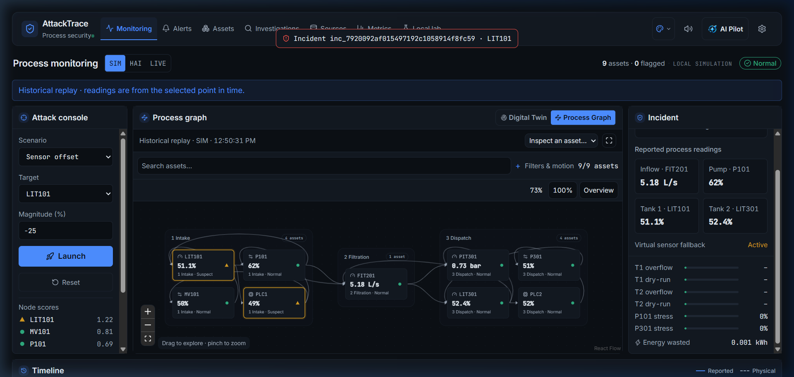
    </td>
    <td width="50%" align="center">
      <b>Causal Graph with Ambient Telemetry Particles</b><br/>
      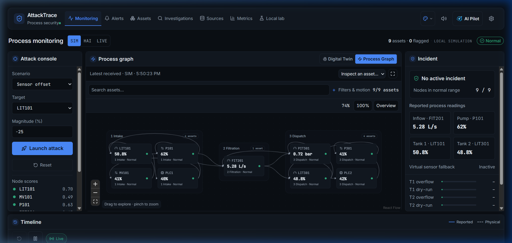
    </td>
  </tr>
  <tr>
    <td width="50%" align="center">
      <b>Attack Simulation &amp; Real-Time Incident Propagation</b><br/>
      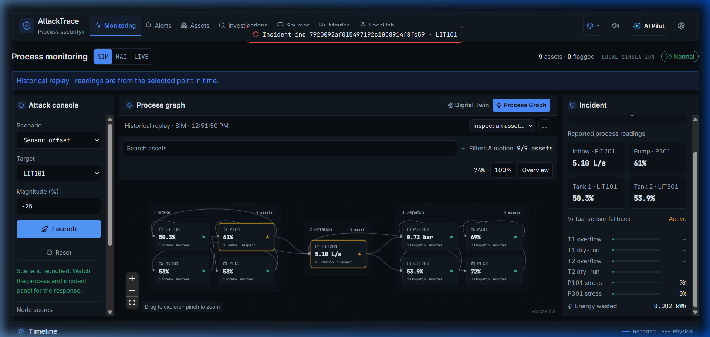
    </td>
    <td width="50%" align="center">
      <b>AI Pilot Signal Room &amp; Gemini Live Voice Assistant</b><br/>
      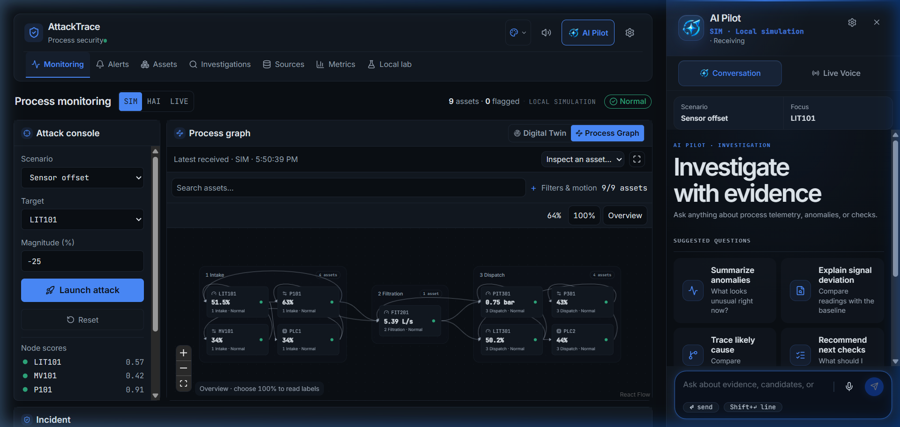
    </td>
  </tr>
  <tr>
    <td width="50%" align="center">
      <b>Security Alerts Queue &amp; Operational Triage</b><br/>
      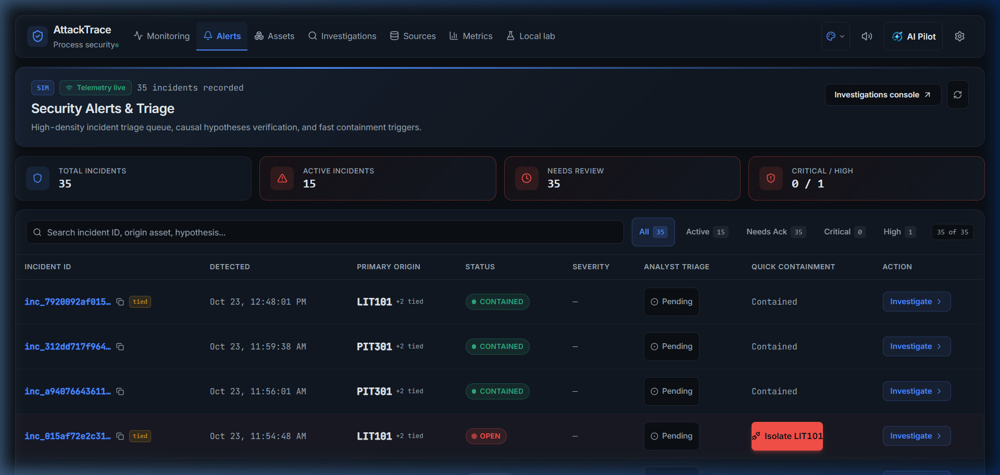
    </td>
    <td width="50%" align="center">
      <b>Asset Inventory with Live Telemetry Range Gauges</b><br/>
      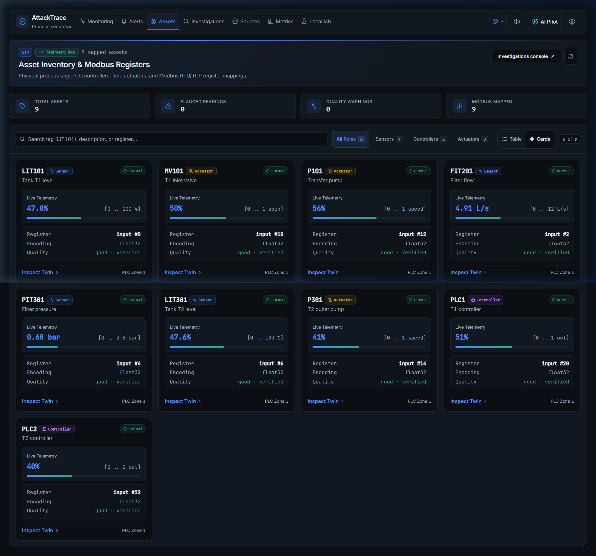
    </td>
  </tr>
  <tr>
    <td width="50%" align="center">
      <b>Investigation Journal with Causal Sequence Stepper</b><br/>
      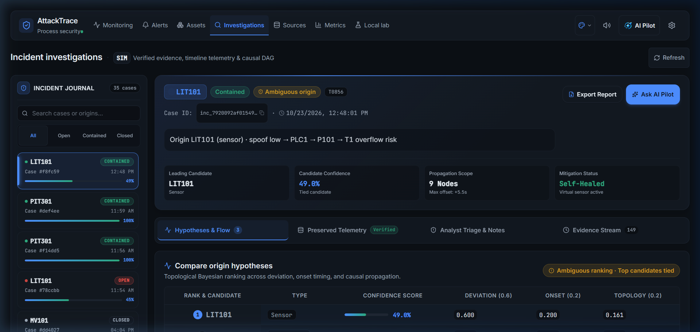
    </td>
    <td width="50%" align="center">
      <b>Threat Metrics &amp; Side-by-Side GDN Baseline Comparison</b><br/>
      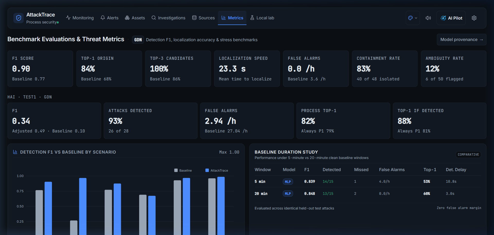
    </td>
  </tr>
  <tr>
    <td width="50%" align="center">
      <b>Modbus Ingestion Pipeline &amp; Verification Matrix</b><br/>
      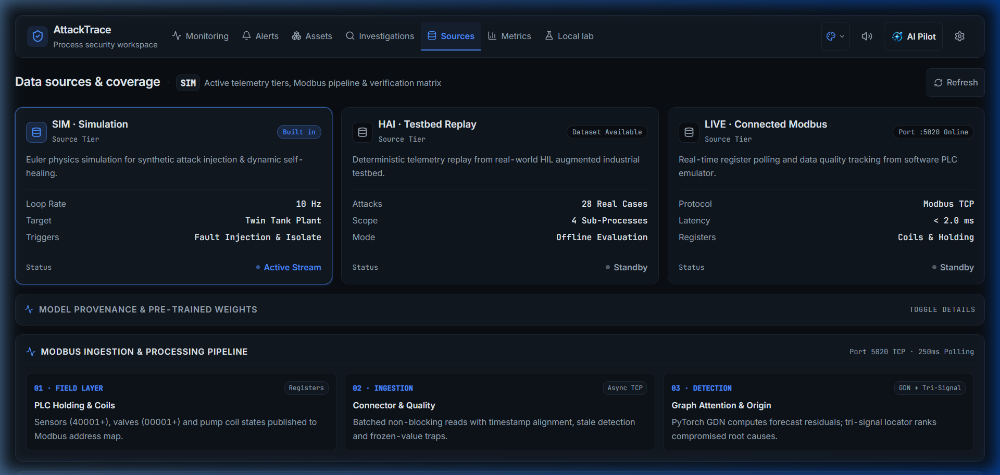
    </td>
    <td width="50%" align="center">
      <b>Local Lab Attack Simulation &amp; Controller Integrity</b><br/>
      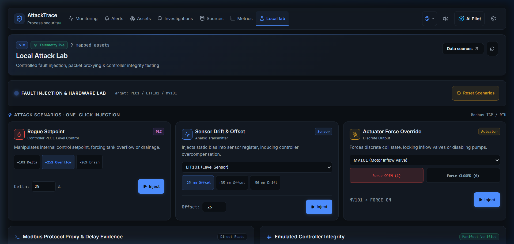
    </td>
  </tr>
</table>

---

## 🛠 Technology Stack

| Domain | Technologies & Libraries | Key Application & Role |
| :--- | :--- | :--- |
| **Frontend Framework** | **React 18 / 19**, **TypeScript 5.9**, **Vite 8** | High-performance reactive UI, strict typing, sub-second HMR builds |
| **State & Flow** | **Zustand 5**, **@xyflow/react 12** | Centralized telemetry buffer, dynamic 2D directed causal graph with ambient particle flows |
| **Visuals & Charts** | **Apache ECharts 6**, **Framer Motion 14**, **Tailwind CSS 4** | Streaming multi-sensor timeline sparklines, live range gauges, fluid liquid physics |
| **Audio Synthesis** | **Web Audio API** (Browser-Native) | Zero-dependency 800/600 Hz warble sirens and major-chord containment chimes |
| **Backend Framework** | **Python 3.11+**, **FastAPI 0.115+**, **Uvicorn**, **Starlette** | High-throughput asynchronous REST endpoints and 2 Hz telemetry WebSocket hub |
| **Data Validation** | **Pydantic v2.8+** | Strict request/response schemas, fail-closed runtime settings validation |
| **GenAI & Voice** | **Google Gemini API** (`google-genai 2.25+`) | `gemini-3.8-live` (bidirectional audio), `gemini-3.8-flash` & `gemini-3.5-flash-lite`, voice action parser |
| **Graph Neural Network** | **PyTorch 2.3+** (CPU-Optimized) | Graph Deviation Network (GDN) forecaster with graph attention mechanisms |
| **Machine Learning** | **scikit-learn 1.5+**, **NumPy 1.26+**, **SciPy 1.13+**, **NetworkX 3.3+** | Isolation Forest baseline, EWMA filtering, causal graph topological traversal |
| **Industrial Protocol** | **PyModbus 3.15+**, **PyYAML 6.0** | Non-blocking Modbus TCP polling (sub-2ms), software PLC register emulator |
| **Databases** | **SQLite (WAL Mode)** | Persistent forensic audit logs, immutable incident captures, case investigations |
| **Cloud Hosting** | **Vercel** (Edge CDN) + **Render** (Docker Web Service) | Serverless frontend hosting paired with auto-healing containerized backend |
| **Edge Gateway** | **Cloudflare Workers** (Wrangler) | Single-origin reverse proxy unifying domains with enterprise CSP & HSTS |
| **Testing & Quality** | **Vitest 5 (152 tests)**, **Playwright 1.63**, **Pytest 8.2**, **Ruff**, **Mypy** | End-to-end browser tests, paired-evidence checks, strict static type validation |
| **Architecture Graph** | **Graphify** | Persistent 2,895-node knowledge graph with automated AST symbol extraction |

---

## 🏛 5-Layer System Architecture (Graphify Mapped)

*Architectural map extracted by **Graphify** across 2,895 nodes, 9,137 edges, and 127 community clusters.*

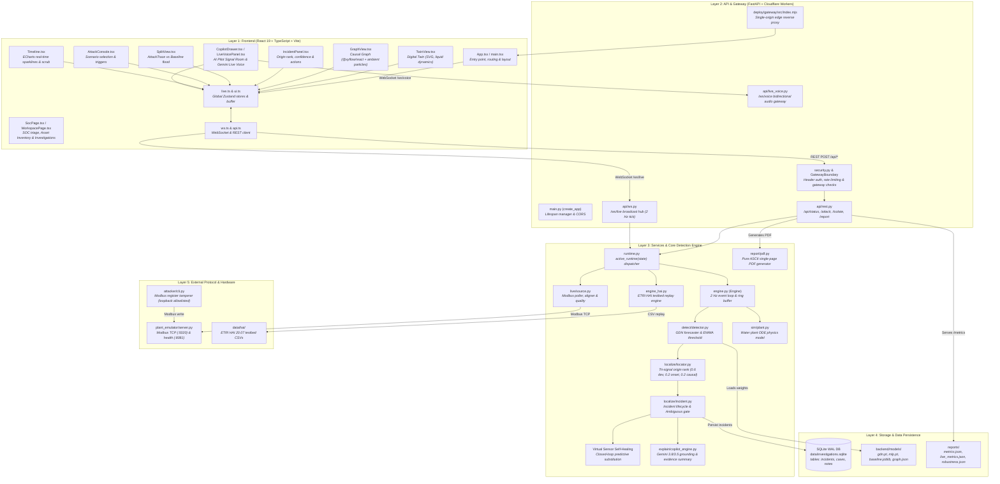

---

## 🔍 Layer-by-Layer Component Breakdown

### 🎨 Layer 1: Frontend (React 19 + TypeScript + Vite)
| Component / Module | Source File | Description |
|---|---|---|
| **Entry Point** | [`frontend/src/main.tsx`](frontend/src/main.tsx) | Initializes application container `#root`. |
| **Main App Shell** | [`frontend/src/app/App.tsx`](frontend/src/app/App.tsx) | Controls layout, mode switching, center view routing (Twin vs Graph vs Split), and error banners. |
| **Digital Twin** | [`frontend/src/features/twin/TwinView.tsx`](frontend/src/features/twin/TwinView.tsx) | SVG animated visualization of tanks T1/T2 with liquid levels, valves MV101, PLCs, and pumps. |
| **Node Badges** | [`frontend/src/features/twin/NodeBadge.tsx`](frontend/src/features/twin/NodeBadge.tsx) | Badges displaying real-time sensor metrics, quality flags, and spoofed vs true readings. |
| **Causal Graph** | [`frontend/src/features/graph/GraphView.tsx`](frontend/src/features/graph/GraphView.tsx) | Interactive directed graph layout built on `@xyflow/react` showing propagation pulses. |
| **Incident Panel** | [`frontend/src/features/incident/IncidentPanel.tsx`](frontend/src/features/incident/IncidentPanel.tsx) | Displays top candidate origin, confidence scores, propagation sequence, and MITRE ICS IDs. |
| **Containment Action** | [`frontend/src/features/incident/IsolateButton.tsx`](frontend/src/features/incident/IsolateButton.tsx) | Triggers Virtual Sensor Self-Healing on the suspected compromised component. |
| **Split Comparison** | [`frontend/src/features/split/SplitView.tsx`](frontend/src/features/split/SplitView.tsx) | Side-by-side view contrasting baseline alarm flooding (6+ nodes) with AttackTrace. |
| **Attack Console** | [`frontend/src/features/console/AttackConsole.tsx`](frontend/src/features/console/AttackConsole.tsx) | Operator console for launching 5 attack scenarios (offset, ramp, freeze, scale, replay). |
| **AI Pilot (Signal Room)** | [`frontend/src/features/copilot/CopilotDrawer.tsx`](frontend/src/features/copilot/CopilotDrawer.tsx) | Full-height responsive investigation drawer with evidence grounding and numbered triage paths. |
| **Live Voice Panel** | [`frontend/src/features/copilot/LiveVoicePanel.tsx`](frontend/src/features/copilot/LiveVoicePanel.tsx) | Real-time bidirectional voice assistant interface with stateful orbit/waveform visualization. |
| **Operator Action Parser** | [`frontend/src/lib/pilotActions.ts`](frontend/src/lib/pilotActions.ts) | Client-side intent parser executing conversational voice/text actions with user confirmation. |
| **SOC & Asset Inventory** | [`frontend/src/features/investigation/SocPage.tsx`](frontend/src/features/investigation/SocPage.tsx) | Real-time triage queue, dense asset inventory with live range gauges, and local lab simulation. |
| **Investigation Journal** | [`frontend/src/features/investigation/WorkspacePage.tsx`](frontend/src/features/investigation/WorkspacePage.tsx) | Case investigation journal with 5-layer verification matrix and causal sequence stepper (`▶`). |
| **Telemetry Timeline** | [`frontend/src/features/timeline/Timeline.tsx`](frontend/src/features/timeline/Timeline.tsx) | Streaming multi-sensor sparklines with historical time-scrubbing and pause/resume controls. |
| **Metrics Dashboard** | [`frontend/src/features/metrics/MetricsPage.tsx`](frontend/src/features/metrics/MetricsPage.tsx) | Benchmark tables for F1 score, Top-1/Top-3 localization accuracy, and Modbus latency. |
| **Zustand Store** | [`frontend/src/store/live.ts`](frontend/src/store/live.ts) | Centralized state store managing telemetry buffer, active incidents, and connection health. |
| **WebSocket Client** | [`frontend/src/lib/ws.ts`](frontend/src/lib/ws.ts) | Resilient WebSocket connection to `/ws/live` with automatic reconnection and fallback. |

---

### ⚡ Layer 2: API & Gateway (FastAPI + Cloudflare Workers)
| Component / Module | Source File | Description |
|---|---|---|
| **Edge Gateway** | [`deploy/gateway/src/index.mjs`](deploy/gateway/src/index.mjs) | Cloudflare Worker reverse proxy combining Vercel frontend and Render backend into a single origin. |
| **Gateway Config** | [`deploy/gateway/wrangler.jsonc`](deploy/gateway/wrangler.jsonc) | Cloudflare Wrangler configuration routing `/api/*` and `/ws/live` to Render and `/` to Vercel. |
| **FastAPI Root** | [`backend/app/main.py`](backend/app/main.py) | Application factory (`create_app`), async lifespan management, CORS configuration. |
| **Gateway Boundary** | [`backend/app/api/gateway.py`](backend/app/api/gateway.py) | Middleware verifying reverse proxy tokens and managing WebSocket upgrades. |
| **Security & Auth** | [`backend/app/api/security.py`](backend/app/api/security.py) | Header-based authentication (`X-API-Key == AT_API_KEY`), sliding-window attack rate limiting. |
| **REST Controller** | [`backend/app/api/rest.py`](backend/app/api/rest.py) | Endpoints: `GET /api/status`, `POST /api/mode`, `POST /api/attack`, `POST /api/isolate`, `GET /api/incidents`, `GET /api/incidents/{id}/report.pdf`. |
| **WebSocket Hub** | [`backend/app/api/ws.py`](backend/app/api/ws.py) | Broadcast hub dispatching engine telemetry ticks to connected frontends at 2 Hz (`/ws/live`). |
| **Live Voice WS** | [`backend/app/api/live_voice.py`](backend/app/api/live_voice.py) | WebSocket bridge streaming PCM16 audio bidirectionally with Google Gemini Live API. |
| **Pydantic Schemas** | [`backend/app/schemas.py`](backend/app/schemas.py) | Strict data schemas for `Sample`, `Incident`, `OriginCandidate`, `PathStep`, and `AttackRequest`. |

---

### 🧠 Layer 3: Services & Core Detection Engine
| Component / Module | Source File | Description |
|---|---|---|
| **Core Engine** | [`backend/app/engine.py`](backend/app/engine.py) | Orchestrates physics step, detector execution, localization ranking, and 5-minute ring buffer. |
| **Runtime Dispatcher** | [`backend/app/runtime.py`](backend/app/runtime.py) | Polymorphic runtime switcher selecting `Engine` (SIM), `HaiEngine` (HAI), or `LiveRuntime` (LIVE). |
| **GDN Forecaster** | [`backend/app/detect/forecaster.py`](backend/app/detect/forecaster.py) | Graph Deviation Network with graph attention layers predicting expected sensor values. |
| **Streaming Detector** | [`backend/app/detect/detector.py`](backend/app/detect/detector.py) | Calculates forecast residuals, applies EWMA filter ($\alpha = 0.25$), and checks 3-sample persistence. |
| **Baseline Detector** | [`backend/app/detect/baseline.py`](backend/app/detect/baseline.py) | Traditional baseline: Isolation Forest combined with $3\sigma$ thresholding for split comparison. |
| **Origin Localizer** | [`backend/app/localize/locator.py`](backend/app/localize/locator.py) | Tri-signal ranking algorithm: $0.6 \times \text{Deviation} + 0.2 \times \text{Onset} + 0.2 \times \text{Causal}$. |
| **Incident Manager** | [`backend/app/localize/incident.py`](backend/app/localize/incident.py) | Manages incident states (`new`, `active`, `contained`, `closed`) and evaluates ambiguity gates. |
| **Copilot Engine** | [`backend/app/explain/copilot_engine.py`](backend/app/explain/copilot_engine.py) | Grounded evidence summarizer and Gemini integration with zero-hallucination fallback. |
| **MITRE ICS Mapper** | [`backend/app/explain/templates.py`](backend/app/explain/templates.py) | Maps components to MITRE ATT&CK for ICS technique IDs (`T0856`, `T0831`, `T0855`) and actions. |
| **Plant Simulator** | [`backend/app/sim/plant.py`](backend/app/sim/plant.py) | 10 Hz Euler ODE numerical solver simulating 2-stage water plant hydraulics and control logic. |
| **Live Modbus Source** | [`backend/app/live/source.py`](backend/app/live/source.py) | Non-blocking Modbus TCP poller, sample aligner, and quality tracking engine (`Good`, `Stale`, `Frozen`). |
| **PDF Report Service** | [`backend/app/report/pdf.py`](backend/app/report/pdf.py) | Dependency-free ASCII/PostScript PDF engine generating official 1-page audit certificates. |

---

### 💾 Layer 4: Storage & Data Persistence
| Component / Module | Source File | Description |
|---|---|---|
| **Incident SQLite DB** | [`backend/app/soc.py`](backend/app/soc.py) | SQLite database (`data/investigations.sqlite`, WAL mode) storing immutable incident evidence and cases. |
| **Neural Weights** | [`backend/models/`](backend/models/) | Pre-trained PyTorch checkpoints (`gdn.pt`, `mlp.pt`), `baseline.joblib`, and causal `graph.json`. |
| **Evaluation Reports** | [`reports/`](reports/) | Benchmark results (`metrics.json`, `robustness.json`, `baseline_comparison.json`) with F1 scores and ROC metrics. |

---

### 🏭 Layer 5: External Protocol & Hardware
| Component / Module | Source File | Description |
|---|---|---|
| **Plant Emulator** | [`plant_emulator/server.py`](plant_emulator/server.py) | Modbus TCP server on port `5020` simulating hardware registers for PLC coils and holding registers. |
| **Tag Map Configuration** | [`config/tagmap.yaml`](config/tagmap.yaml) | Mapping file linking human-readable tag names (`LIT101`, `MV101`) to Modbus register addresses. |
| **Attacker Tool** | [`attacker/cli.py`](attacker/cli.py) | Standalone penetration test tool allowlisted to loopback to inject sensor offsets via Modbus writes. |
| **HAI Testbed** | [`data/hai/`](data/hai/) | Dataset files from Korean ETRI hardware testbed used for evaluation replay. |

---

## 🔄 End-to-End Incident Lifecycle

```mermaid
sequenceDiagram
    autonumber
    actor Operator as Plant Operator
    participant UI as React UI (Digital Twin)
    participant REST as FastAPI REST API
    participant Engine as Engine (2 Hz Loop)
    participant Plant as Sim Plant / Modbus Emulator
    participant GDN as GDN Forecaster
    participant Localizer as Tri-Signal Localizer
    participant Store as SQLite DB / PDF Engine

    Operator->>UI: 1. Select scenario & click "Launch" (e.g. LIT101 sensor offset)
    UI->>REST: POST /api/attack {target: "LIT101", scenario: "sensor_offset", mag: -25}
    REST->>Engine: launch(attack_spec)
    Engine->>Plant: Apply spoofing offset on LIT101
    
    loop Every 500 ms (2 Hz)
        Engine->>Plant: Step physics / Poll Modbus registers
        Plant-->>Engine: Telemetry sample (true & measured values)
        Engine->>GDN: predict(window)
        GDN-->>Engine: Forecast residual error
        Engine->>Localizer: check_sustained(errors)
        alt Residual exceeds threshold for 3 samples
            Localizer->>Localizer: Compute deviation (0.6) + onset (0.2) + causal (0.2)
            Localizer-->>Engine: Incident detected: Origin = LIT101 (84% conf)
            Engine->>Store: Save incident to SQLite
        end
        Engine-->>UI: WebSocket broadcast (Sample + Incident state)
    end

    UI->>UI: Status turns to INCIDENT; Siren sounds; LIT101 badge glows red
    Operator->>UI: 2. Click "Isolate LIT101"
    UI->>REST: POST /api/isolate {incident_id, node_id: "LIT101"}
    REST->>Engine: isolate("LIT101")
    Engine->>Plant: Engage Virtual Sensor Self-Healing (substitute predicted value)
    Plant-->>Engine: Tank levels stabilize; process returns to 50% setpoint
    Engine-->>UI: Status changes to CONTAINED (Chime sounds)
    Operator->>UI: 3. Click "Report" icon
    UI->>REST: GET /api/incidents/{id}/report.pdf
    REST->>Store: Render PDF PostScript
    REST-->>Operator: 1-page forensic incident audit report downloaded
```

---

## 📊 Benchmark & Evaluation Results

Evaluated on held-out test attacks across 50 attack runs (10 per scenario), 20 clean 5-minute runs, and unseen random seeds. Source: `reports/metrics.json`.

| Metric | AttackTrace (Our GDN) | Baseline (Isolation Forest + 3σ) | Improvement |
| :--- | :---: | :---: | :---: |
| **Detection F1** | **0.904** | 0.766 | **+18.0%** |
| **False Alarms / Hour** | **0.0** | 3.6 | **100% reduction** |
| **Origin Top-1 Accuracy** | **84.0%** | 68.0% | **+23.5%** |
| **Origin Top-3 Accuracy** | **100.0%** | 86.0% | **+16.3%** |
| **Mean Localization Time** | **23.3 s** | *N/A (Alarm flood)* | — |
| **Self-Healing Containment**| **40 / 48 (83.3%)** | 0 / 48 | **Automated recovery** |

- **LIVE Mode (Modbus TCP)**: Detection F1 **0.951**, Top-1 Origin **83.3%**, read latency **p50 1.6 ms / p95 2.4 ms** (`reports/live_metrics.json`).
- **HAI 20.07 Dataset**: Strict F1 **0.428**, Point-adjusted F1 **0.915**, detecting 22 of 28 real-world physical attacks.

---

## ⚡ Quick Start

### Option 1: Open the Live Cloud Dashboard
Visit [https://tech-wizards-attacktrace.vercel.app](https://tech-wizards-attacktrace.vercel.app) or [https://attacktrace-console.jinsu-j2005.workers.dev](https://attacktrace-console.jinsu-j2005.workers.dev).

### Option 2: Run with Docker Compose
```bash
# 1. Clone repository
git clone https://github.com/jinsu-2005/TechWizards.git
cd TechWizards

# 2. Configure environment
cp .env.example .env
# Optional: Add GEMINI_API_KEY in .env to enable AI Pilot features

# 3. Start full stack (Frontend, Backend, and Models)
docker compose up --build

# 4. Open in browser:
# UI:  http://localhost:5173
# API: http://localhost:8000/api/status
```

### Option 3: Local Development
```bash
# Prerequisites: Python 3.11+, Node.js 22+

# Backend
cd backend
python -m venv .venv
source .venv/bin/activate    # Windows: .venv\Scripts\activate
pip install -e .
uvicorn app.main:app --reload --port 8000

# Frontend
cd ../frontend
npm install
npm run dev
```

---

## 🎮 Interactive Live Demo Script

1. **Verify Baseline State**: Open the dashboard. Top right status pill reads **Normal** (green). Ambient SVG particles flow along healthy process graph edges.
2. **Enable Audio**: Click the **Speaker** icon in the header to activate Web Audio synthesis (dual-frequency warble siren & major-chord containment chime).
3. **Launch an Attack**:
   - **Via GUI**: In the **Attack Console** (left pane), select **Sensor offset**, target **LIT101** with Magnitude `-25%`, and click **Launch**.
   - **Via AI Pilot Voice/Text**: Open **AI Pilot**, speak or type *"Launch sensor offset on LIT101 at -25%"*, and confirm the action card.
4. **Observe Real-Time Detection**:
   - Within seconds, an audible dual-frequency warble siren (800 Hz / 600 Hz) triggers and the panel pulses red.
   - The **Incident Panel** highlights `LIT101` as the Top-1 origin candidate with a high confidence score.
   - Dynamic glowing threat propagation waves trace along downstream causal edges toward pumps `P101`, `P301`, and Tank 2.
5. **Engage AI Pilot (Signal Room)**:
   - Ask: *"Why was LIT101 identified as the origin?"* or *"What physical damage will occur?"*
   - Or start **Live Voice** to conduct hands-free conversational triage with Gemini.
   - Command: *"Switch data source to live"* or *"Reset the simulator"* for instant automated execution.
6. **Activate Self-Healing**:
   - Click **Isolate LIT101** in the incident panel or inside the AI Pilot drawer.
   - A major-chord containment chime sounds and LIT101 receives a cyan **VIRTUAL** badge.
   - Closed-loop virtual sensor prediction takes over pump regulation, smoothly restoring Tank 1 to setpoint equilibrium.
7. **Navigate Modernized SOC Workspaces**:
   - **Security Alerts (`/alerts`)**: High-density incident triage table with one-click acknowledgment and containment.
   - **Asset Inventory (`/assets`)**: Visual sensor and actuator cards with real-time operational range gauges and Modbus register maps.
   - **Investigations (`/investigations`)**: Step-by-step causal timeline steppers (`▶`), origin hypothesis comparison, and analyst notes.
   - **Metrics & Benchmarks (`/metrics`)**: Primary KPI cards and side-by-side GDN vs Baseline comparison charts.
8. **Export Forensics**:
   - Click the **PDF Report** icon in the incident card to download an audit summary certificate.

---

## 🗺 Graphify Codebase Navigation

The entire codebase is indexed into a persistent **Graphify Knowledge Graph** (`graphify-out/`):

- **Interactive 2D/3D Graph Visualization**: [`graphify-out/graph.html`](graphify-out/graph.html)
- **Call-Flow Hierarchy**: [`graphify-out/Attacktrace-callflow.html`](graphify-out/Attacktrace-callflow.html)
- **Graph Metrics & Community Report**: [`graphify-out/GRAPH_REPORT.md`](graphify-out/GRAPH_REPORT.md)

CLI inspection commands:
```bash
# Query any concept, function, or subsystem
graphify query "How does virtual sensor self-healing work?"

# Trace dependencies or relationship paths between two nodes
graphify path "Engine" "VirtualSensor"

# Deep-dive into a specific abstraction or God Node
graphify explain "backend_app_engine_engine"
```

---

## 📄 License & Attribution

- **Project License**: MIT License (see [`LICENSE`](LICENSE)).
- **Third-Party Disclosures**: Third-party libraries, datasets (HAI 20.07), fonts, and MITRE ICS tags are documented in [`submission/THIRD_PARTY.md`](submission/THIRD_PARTY.md).
