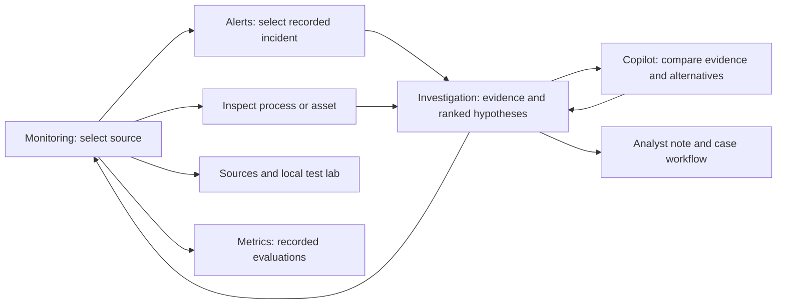

# AttackTrace UI and navigation repair — 16 October 2026

Deployment is deferred until usability is verified. This work improves the existing React/Tailwind,
SVG twin and React Flow workspace; it does not replace working telemetry with a decorative 3D scene.

## Observed problems

The live browser review found a crowded monitoring header, different navigation on secondary pages,
full-document reloads between screens, a 640px-tall process row at tablet widths, and controls/incident
details pushed below it. The Copilot empty state repeats generic introductory text and exposes a
copy action before a useful answer. Mobile navigation and investigation tables need clearer paths.
These observations come from fresh browser inspection, not the earlier screenshots in this project.

## Design direction

A calm industrial investigation workspace: stable navigation, explicit selected source, readable
status and evidence, and one primary task per region. Retain all existing theme tokens, icon family,
self-hosted fonts, scientific caveats and server-enforced action permissions. Color signals must keep
their meaning across themes; added motion should communicate source/process state.

Guidance read: UI/UX Pro Max (navigation, touch targets, focus, responsive structure), and the requested
3Dviz Pro Max (composition, truthful controls and inspection at the actual viewing scale). The UI
skill's broad search also suggested a marketing landing pattern; that part was rejected as a poor fit
for this dashboard. No catalog output is treated as a validated design or a measured physical model.

## Implementation order

1. **One navigation system.** Consistent brand/home link, current-page indication and the same
   destinations on every screen. Separate primary destinations from source controls and utility
   actions. Use in-app navigation with working Back/Forward and preserved query deep links.
2. **Monitoring hierarchy.** Clear page title/status; compact source toolbar; responsive desktop
   columns. On small screens, directly switch between process, test scenario and incident panels.
   Remove conflicting fixed-height overrides that bury important controls.
3. **Readable process workspace.** Make Fit actually fit the viewport; retain zoom, scrolling and
   asset selection for close inspection. Keep an explicit route from a selected asset to its evidence.
4. **Copilot polish.** Useful starting tasks, clear source/incident context, readable answer type and
   composer, consistent close/reset controls. Retain evidence disclosures, request cancellation and
   operational guards. Do not present inference as a confirmed attack origin.
5. **Investigation journey.** Alerts lead to the exact case, assets lead to selected process tags,
   and investigations can return to monitoring or ask Copilot. Improve small-screen incident lists
   instead of requiring users to pan a wide table to find the primary action.
6. **Browser verification.** Capture before/after at desktop and phone widths; inspect light and dark
   themes, process graph/twin, Copilot reply/evidence, navigation, Back/Forward, focus and overflow.
   Record observed failures and pending checks separately. Run frontend lint, tests and production build.

## Intended operator flow

## Acceptance and reporting

- No blank full-page reload for ordinary internal navigation; browser history and deep links work.
- Current page, selected data source and historical/current context are distinguishable.
- Scenario and incident panels are reachable without traversing a large mobile process canvas.
- No page-level horizontal overflow at 390px; wide scientific tables/canvases may scroll inside a
  named region with accessible alternatives.
- Fit/zoom, Copilot keyboard operation and primary task controls are observed in the real browser.
- Before/after screenshots are saved under `docs/ui-review/2026-10-16/` and embedded in delivery.
- A successful build is not visual approval. Screen-reader, hosted OAuth or unobserved theme states
  are never described as checked merely because tests passed.

## Additional constraints from the six user screenshots

- Do not approve the UI from the scaled 1440×900 preview. Verify actual CSS viewport bounds at
  phone/tablet/laptop/wide sizes, and distinguish screenshot preview scale from browser zoom.
- Use one fluid page width/gutter system for Monitoring, Alerts, Assets, Investigations, Sources,
  Metrics and Local lab. Improve readable text and let content grow vertically without clipping.
- Build phone layouts first, progressively reveal tablet/desktop grids, and use auto-fit for source
  cards and lab forms. Keep primary controls at least 44 CSS pixels high on touch layouts.
- Collapse raw hashes/configuration into references; show a meaningful configuration state first.
- Review every route, not only the dashboard, at the responsive widths recorded in the review report.
